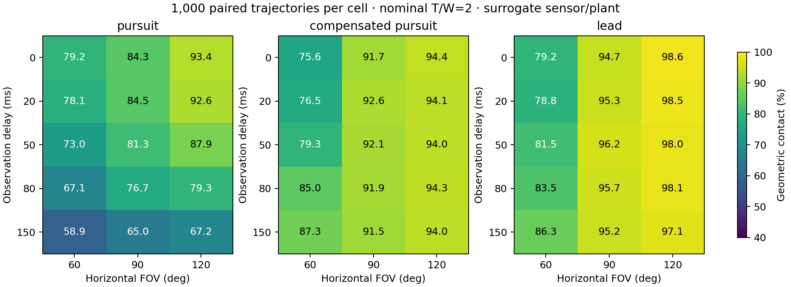

# First research results: visibility, timing and simple guidance

The evidence favors **timestamped relative tracking with simple predictive
guidance** as the next prototype candidate. Camera visibility, acquisition
behavior and perception calibration deserve attention before a more complex
optimizer or higher nominal thrust. This is not yet a final hardware recommendation.

## Evidence collected

- Corrected upstream MuJoCo repository at b9e61ba: **134 tests pass** and **11/11
  M3 benchmark cases pass**. Reference results are retained separately.
- Astra: **156,000 trials** = 1,000 held-out trajectories × 52 conditions × 3
  methods. The same trajectories are reused; there are not 156,000 independent
  target paths. Frozen source revision: **99f6b44**.
- Independent rendered-image calibration: 240 MuJoCo images, each processed at
  three blur levels, for **720 detector evaluations**.
- Rendered closed loop: **432 trials** = 24 new paired trajectories × 2 FOVs ×
  3 methods × 3 sensor conditions. Camera pixels drive the same autonomy.
- Acquisition follow-up: **8,000 trials** on 1,000 additional shared trajectories.

The full geometric benchmark took about 443 seconds on this workstation.
This is experiment runtime, not a companion-computer control-latency result.

## Guidance comparison

Nominal condition: 50 ms image-delivery delay, 90° horizontal FOV, nominal T/W=2,
200 g planning mass with ±10% mass/supply variation, 12-second terminal horizon.

| Method | Contact | Wilson 95% interval | Miss-distance p95 |
|---|---:|---:|---:|
| Delayed-position pursuit | 81.3% | 78.8–83.6% | 1.763 m |
| Compensated pursuit | 92.1% | 90.3–93.6% | 0.208 m |
| Constant-velocity lead | 96.2% | 94.8–97.2% | 0.170 m |

Lead improves over compensated pursuit by **4.1 percentage points**, paired
bootstrap 95% interval **2.5–5.8 points**. This supports a modest advantage under
these assumptions. It does not establish a universal winner.

| Scenario subset (250 each) | Delayed pursuit | Compensated pursuit | Lead |
|---|---:|---:|---:|
| Static | 100% | 100% | 100% |
| Crossing | 66.8% | 83.6% | 97.2% |
| Receding | 90.8% | 98.0% | 98.0% |
| Maneuvering | 67.6% | 86.8% | 89.6% |

The static case starts airborne with the fixture visible and measures geometric
contact. It does not establish launch, search, obstacle avoidance or precise
panel-normal approach. A 0.17 m summed spherical contact radius is used; p95 miss
near 0.17 m should not be described as centimeter-level terminal accuracy.
Successful nominal lead trials have p95 relative contact speed about **5.75 m/s**;
impact survival and permitted contact speed remain unresolved.

## What changes performance

Changing one condition from nominal, lead contact changes as follows:

| Change | Lead contact | Interpretation |
|---|---:|---|
| FOV 60° | 81.5% | Visibility has a large effect |
| FOV 120° | 98.0% | Wider FOV helps the geometric model; pixel accuracy must also be checked |
| T/W 1.5 | 96.0% | Little change in this bounded-tilt task |
| T/W 3 | 96.1% | No useful improvement over nominal 2 here |
| 800 ms occlusion | 61.6% | Loss/reacquisition is a major unresolved weakness |
| Ego drift 0.15 m/s | 96.1% | This relative task tolerates the tested common local drift |
| Camera mounted 20° upward | 98.0% | Body/camera geometry is consequential |
| Known-radius prior 20% too small | 94.3% | Compensated pursuit reaches 94.7%; lead advantage disappears |

The thrust result is physically consistent with the imposed 45° tilt cap: ideal
level-flight horizontal acceleration cannot exceed g at that tilt, even if more
thrust is available. It does not show that high thrust is unnecessary for a
different attitude envelope, braking maneuver or real motor/battery combination.

## Negative results and a challenged benchmark assumption

At 60° FOV, the first sweep sometimes improved when latency increased. We tested
whether initial acquisition behavior caused this instead of assuming delay helps.
On a new paired seed, adding 150 ms latency improved lead from **80.4% to 89.1%**
when guidance began as soon as observations arrived. With a common **500 ms
observation hold**, the same delay reduced lead from **95.4% to 92.7%** (paired
95% difference interval −4.0 to −1.5 points).

The reversal disappears under the common hold. Initial acquisition and maneuver
timing confound a simplistic latency interpretation. This supports testing a
deliberate acquisition phase; it does not prove that 500 ms is an optimal setting.
No evaluation gains or thresholds were tuned after seeing these results.

Rendered pixels reveal another gap. With a 120° camera, the isolated red-sphere
detector's median relative range bias is **+5.5% unblurred** and **−19.1%** under
an 11-pixel horizontal blur. In the latter case it detects **68/80** fixtures,
with **30.8% p95 absolute range error among detections**. The original geometric
sensor already includes size-dependent random error from pixel noise; what it
does not reproduce is this systematic blur-dependent bias and abstention pattern.

In the small rendered closed-loop sample at 120°, lead changes from **24/24**
contacts with geometric/unblurred observations to **21/24** with blur. Delayed
pursuit changes 20→17/24, compensated pursuit 21→18/24. These small samples expose
a failure mechanism; they cannot establish its real-world probability. The
rendered fixture has simple lighting and no clutter, lens distortion, rolling
shutter or vibration. An 11-pixel box blur is a stress condition, not a calibrated
camera exposure model.

## What to build next, and what cannot yet be selected

Keep the existing H743/ArduPilot direction as a **candidate** for stabilization
and local failsafes. Prototype timestamped camera observations, a small tracker,
compensated pursuit and lead on the companion; measure them on the exact camera
before adding MPC or learning. Verify visibility through attitude changes and
explicit target acquisition/reacquisition. Keep low-latency terminal behavior
independent of hangar communications. A simple sequential sortie scheduler can
come later without dictating the guidance architecture.

Do not select an exact motor/prop/voltage/battery from these results. There are
still **zero measured propulsion curves**. The [hardware ledger](hardware.md)
contains a 163.5 g planning allocation and an ordered measurement protocol;
allocations are not measured parts or evidence that the proposed assembly flies.
Actual capture-to-command age, blur, known-size target validity, guarded thrust
curves and impact behavior are the main physical evidence gaps.

The package has not completed full autonomous launch/search/contact missions,
real GPS-denied terminal flight, ArduPilot terminal-guidance SITL integration,
four-UAV operation, power/thermal validation, or hardware transfer. A final exact
competition build recommendation is therefore not earned yet.

## Reproduction and traceability

- [Frozen protocol](protocol.md), [research journal](research_log.md), [risk register](risks.md).
- Geometric campaign: `results/evaluation_v1/{manifest,summary,sensitivity}.json`,
  raw `episodes.jsonl.gz`, source snapshot and report/figures.
- Render calibration: `results/render_validation_v1/`.
- Rendered closed loop: `results/rendered_closed_loop_v1/`.
- Acquisition follow-up: `results/startup_study_v1/`.
- Reference M3 reproduction: `results/reference_m3.json` and `.log`.

All rates include failures in denominators. Contact-time/speed statistics exclude
failed contacts; detector-error statistics exclude abstentions while reporting
their count. Confidence intervals are descriptive per condition. Small method
differences should be weighed against numerical and model uncertainty.
